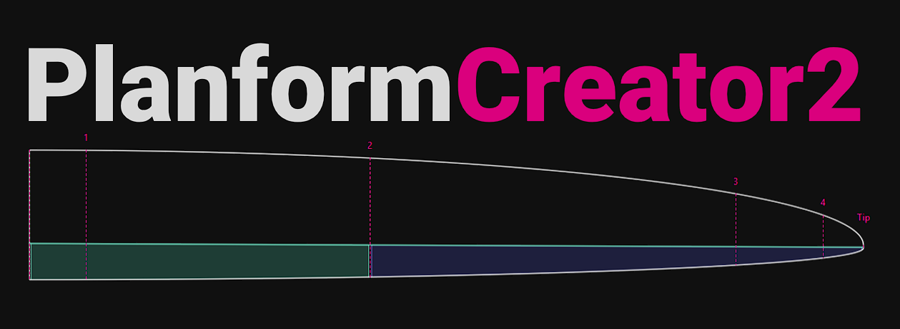

[](https://github.com/jxjo/PlanformCreator2/releases/latest)
[](LICENSE)

# Version 5.0

Version 5.0 integrates [NeuralFoil](https://github.com/peterdsharpe/NeuralFoil) as a fast alternative to Xfoil for airfoil polar generation. Wing analysis now includes drag calculation and glide performance estimates, as well as comparison with a reference wing.

For an introduction to the new features, their background and interactive demos, see [About Version 5.0](doc/About_5.0_en.md).

**PlanformCreator2** (PC2) is an app for parametric wing planform design and wing performance analysis, with a focus on model aircraft. Its interactive workflow combines geometry design with aerodynamic feedback to help compare and refine wing designs.

### Planform Design

* Define a planform using a spanwise chord distribution and a chord reference line
* Import a drawing or photo of an existing wing as a background image
* Add wing sections at fixed span positions or relative chord lengths
* Define the flap hinge line and flap groups
* Export the planform as DXF for use in CAD

### Airfoils and Polars
* Assign airfoils to wing sections and edit them using [AirfoilEditor](https://github.com/jxjo/AirfoilEditor)
* Generate blended airfoils for intermediate wing sections ('strak')
* Generate and view airfoil polars using NeuralFoil or Xfoil

### Wing Performance Analysis
* Automatically panel the wing for aerodynamic calculations
* Calculate lift distribution using the vortex lattice method (VLM)
* Identify critical wing regions where airfoils reach their maximum lift coefficient and stall is expected to begin
* Calculate wing drag and estimate glide performance
* Evaluate wing pitching moment
* Compare performance with a reference wing to assess design changes
* Export the wing's panel mesh and airfoils to Xflr5 and FLZ_vortex for further analysis

The built-in analysis supports wing design exploration and comparison; it is not a complete aircraft-performance prediction.

## Quick Start

**Windows (recommended):** Download and run the latest installer from the [GitHub releases page](https://github.com/jxjo/PlanformCreator2/releases), then launch PlanformCreator2.

**Python package (Python 3.12 or newer):** Install and launch from a terminal:

```shell
pip install planformcreator2
planformcreator2
```

Start by exploring the sample wing in the **Welcome** panel, or use **New** to choose a predefined wing template.

See [Installation](#installation) for detailed setup instructions, including Linux/macOS and Xfoil polar generation.

## Basic Concepts

In PC2, a wing is defined by parameters and mathematical functions rather than by drawing its outline directly. Span, root chord and sweep set the overall dimensions, while the chord distribution and chord reference control the planform shape. These elements can be adjusted independently, either through input fields or by dragging control points in the diagrams.

The design process is iterative: adjust the geometry or airfoil selection, assess the aerodynamic effects, and refine the design. A reference wing provides a baseline for judging whether a change brings the design closer to its intended purpose.

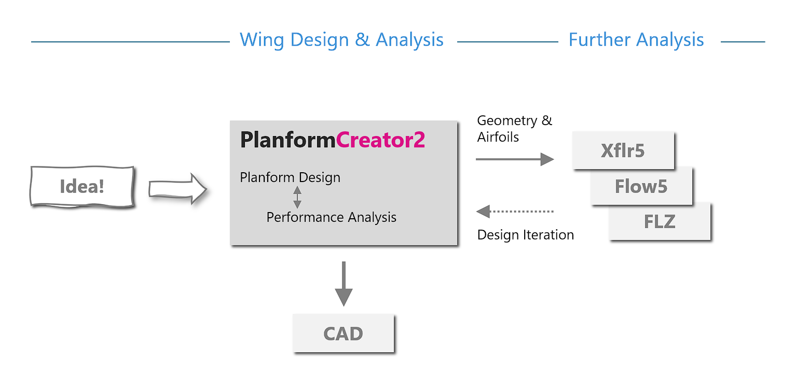

Throughout this process, PC2 remains the single source of truth for wing geometry. For further analysis in external tools, export the wing's panel mesh and airfoils, then apply any resulting design refinements in PC2.

Once the design is finalized, the planform and airfoils can be exported to CAD for final 3D work, such as mold design.


## Designing a Planform

Start with the chord distribution, then use the chord reference to position the leading and trailing edges. Wing sections add airfoil locations and flap boundaries to the resulting planform.

### Chord Distribution and Chord Reference
The chord distribution defines the local chord length along the span. It strongly influences the lift distribution and sets the local Reynolds number for a given flight speed.

Two methods are available for defining the chord distribution:
- **Bezier curve**: Shape the distribution by dragging control points, with tangents controlling its shape at the root and tip. Additional control points allow more complex distributions. Moving the Bezier start point toward the tip creates a constant-chord region near the root.
- **Trapezoid**: Define a single- or multi-trapezoid wing using chord lengths and span positions at the defining wing sections.

The chord distribution is shown with chord length normalized to root chord, ranging from 0 to 1. Spanwise position is shown in the wing's length units.

The chord reference determines how much of the local chord lies ahead of and behind a reference line along the span. Together with the chord distribution, it defines the leading and trailing edges.

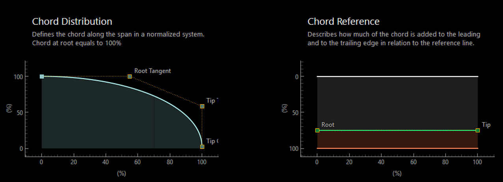

PC2 combines these definitions, scales them to the wing's half-span and root chord, and applies the selected sweep angle to create the planform.

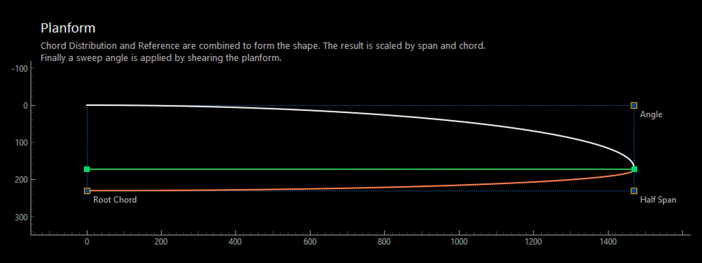


#### Variations of the Chord Reference 

Changing the chord reference allows different planform shapes while preserving the chord distribution. At unchanged span and root chord, these variants have the same wing area and aspect ratio, but changes in sweep can still affect their aerodynamic behavior.

The following diagram shows planform variations with the same chord distribution:
 
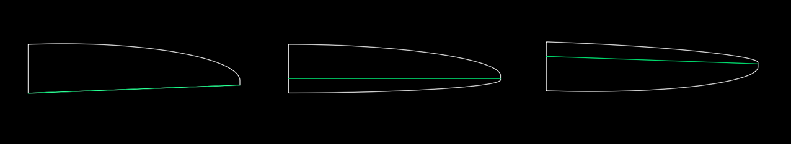


#### The Banana Function

The "banana function" bends the planform's reference line without changing the chord distribution or the chord reference settings. It can create shapes similar to bow-style flying wings.

It can also be used to fine-tune flap depth along the span: with a straight hinge line, bending the planform changes the distance between the hinge line and the trailing edge.

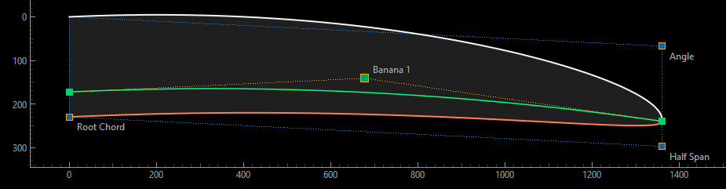

### Background Image

To recreate a wing from a drawing or photo, load it as a background image and adjust the chord distribution and chord reference to match its outline.

A built-in image editor lets you scale the image and adjust its colors for use as a background.

Align and scale the image by placing the two scale markers at the root leading edge and the wing tip.

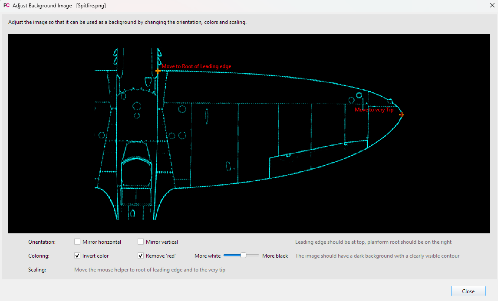


### Wing Sections

Wing sections mark spanwise locations within the planform. They serve two main purposes:
* Position airfoils
* Define hinge line points and flap group boundaries

Every wing has at least two wing sections: root and tip. Additional sections can be added between them. Wing section locations can be defined in two ways:
- **By span position**: The section stays at a fixed fraction of half-span when the wing span or chord distribution changes. This is useful for defining flap boundaries.
- **By chord length**: The section moves along the span to maintain a specified relative chord length as the chord distribution changes. With root chord and flight speed unchanged, this also preserves the local Reynolds number at the assigned airfoil.

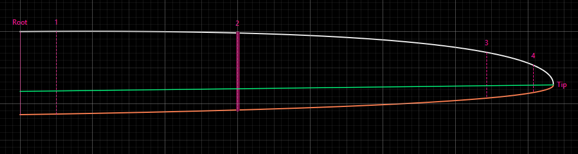

<sup>Section '2' has a fixed span position and defines the boundary between flap and aileron. Section '3' positions an airfoil at a specified relative chord length.</sup>

For trapezoidal planforms, the chord distribution is defined by the wing sections themselves: each defining section specifies both a span position and a chord length, with straight segments connecting them. This differs from a Bezier planform, where the chord distribution is defined independently of the wing sections. Additional sections can be placed between the defining sections without changing the trapezoidal chord distribution.

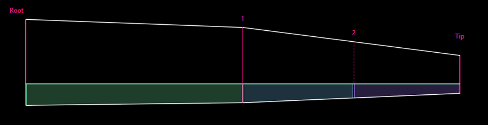

<sup>Sections 'root', '1' and 'tip' define the trapezoidal planform. Section '2' adds a flap boundary without changing its shape.</sup>


### Hinge Line and Flap Depth

Flaps are defined by a hinge line and the wing sections at their spanwise boundaries. Consecutive sections assigned to the same flap group belong to a single flap.

By default, the hinge line follows the planform's reference line.

For independent control of flap depth, define a separate hinge line using hinge points at the root and tip. Additional hinge points at wing sections allow kinks in the line, for example when working with a curved planform reference line.

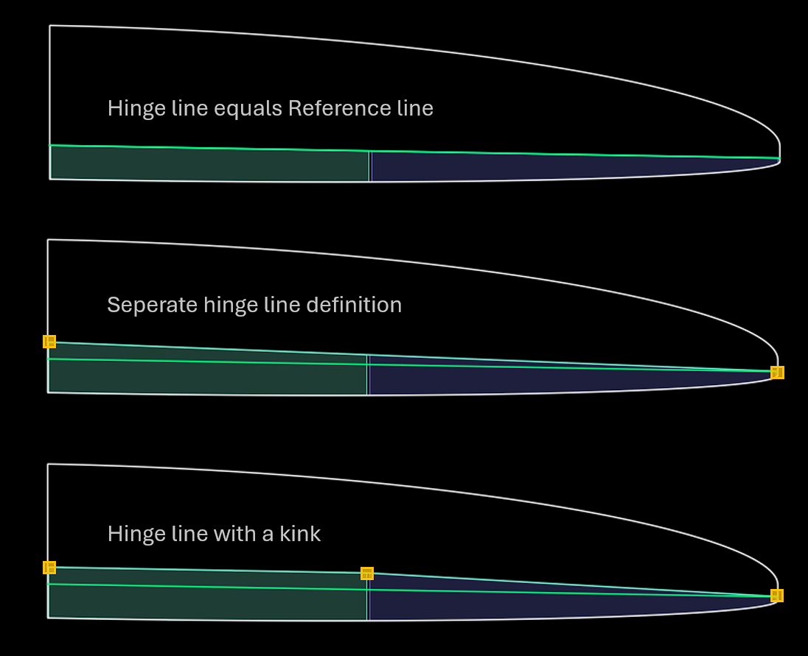

### Export as DXF File
Export the planform as a DXF file for use in CAD. Airfoils can optionally be included in the drawing, exported separately as `.dat` files, or both.

An optional common trailing-edge thickness (TE gap), specified in millimeters, reduces the need to adjust individual airfoils in CAD.

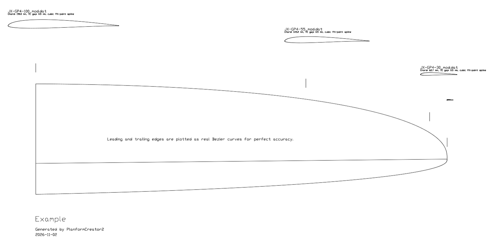

**Note:** Where the planform outline can be represented by Bezier curves, DXF export uses uniform B-splines to preserve its shape. Airfoils are exported as B-splines (Bezier-based airfoils) or as cubic splines (`.dat` airfoils). A cubic-spline export option is available for CAD tools that need it.

### Export as CSV File

Export wing section geometry, including spanwise positions and leading- and trailing-edge coordinates, as a CSV file for further processing in tools such as Excel.


## Airfoils and Polars

### Assignment of Airfoils

Assign airfoils to the wing sections that define the airfoil progression along the span. At unassigned sections, PC2 automatically creates a blended airfoil ('strak') from the nearest assigned airfoils on either side.

The blending ratio is based on relative chord lengths. If the two assigned sections have the same chord length, their spanwise positions determine the ratio instead.

Root and tip sections must always have assigned airfoils; example airfoils are provided initially.

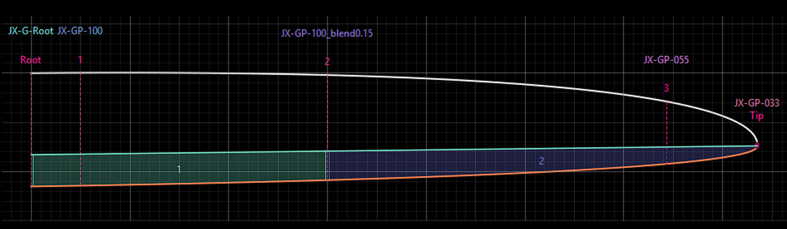

<sup>Wing sections with the corresponding airfoils. The airfoil at 'section 2' is created by blending JX-GP-100 and JX-GP-055.</sup>


View airfoils in normalized form to compare their shapes, or at their actual size within the wing sections.

Open an assigned airfoil in [AirfoilEditor](https://github.com/jxjo/AirfoilEditor) to modify its shape during wing design. Blended airfoils follow their assigned neighbors automatically and cannot be edited directly.

All section airfoils, including blended airfoils, can be exported as `.dat` files. The export can optionally apply a common trailing-edge thickness (TE gap) in millimeters.


### Airfoil Polars

PC2 supports two methods for generating airfoil polars:

* **NeuralFoil** provides fast predictions, making it useful for interactive exploration of airfoil and wing designs.
* **Xfoil**, run through Worker from the [Xoptfoil2 project](https://jxjo.github.io/Xoptfoil2), generates polars in background tasks and supports multi-threaded calculation of polar sets.

Choose the calculation method and flow conditions in the polar definition. Polars are generated on demand rather than requiring a separate preparation step. For both methods, `auto_range` adjusts the angle-of-attack range to cover the T1 polar from minimum to maximum lift coefficient. Xfoil-format polar files can also be imported into Xflr5.

Define the Reynolds number at the root section. PC2 scales it by the local chord length at each other section, so the resulting polar set represents consistent flow conditions along the wing.

Polar definitions can also include a flap setting, allowing comparison of airfoil performance with and without flap deflection.

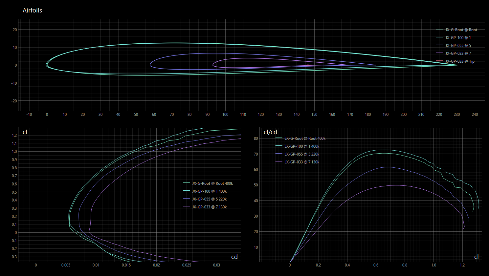
<sub>Airfoil and polar view showing auto-generated, Reynolds number-adjusted polars for airfoils at defined wing sections.</sub>

Compare the section polars to assess the airfoil progression before analyzing the complete wing. Pay particular attention to smaller-chord regions, where lower Reynolds numbers can reduce airfoil performance.

## Paneling

Paneling prepares the designed wing for aerodynamic calculation by dividing its surface into a mesh of panels used by the built-in VLM analysis or exported to external analysis tools.

The mesh is a discretized representation of the wing, separate from the parametric planform. Its type and resolution determine how closely it follows the designed geometry and how finely the aerodynamic calculation resolves the wing. Paneling settings can therefore be adjusted without changing the design itself.

PC2 provides two mesh types: **Trapezoidal** and **Smooth**. Both are available for built-in wing analysis; export to Xflr5 and FLZ_vortex requires a trapezoidal mesh.

### Trapezoidal Mesh

A trapezoidal mesh connects wing sections with straight leading and trailing edges. It directly represents trapezoidal planforms and provides the mesh structure required by Xflr5 and FLZ_vortex.

For Bezier-based planforms, this approximation can deviate significantly from the curved outline if too few sections are used. Set the chordwise (x) and spanwise (y) panel counts and distributions, then refine the mesh to reduce these geometric deviations.

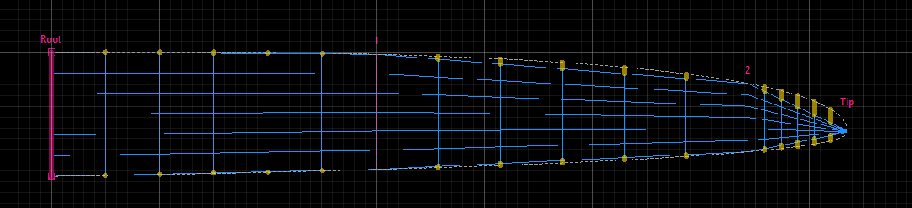

<sup>Initial trapezoidal mesh with only one section between root and tip. Yellow lines mark the deviation from the designed planform.</sup>

The **maximum chord deviation** option automatically inserts panel-only sections until the trapezoidal approximation is within the selected tolerance. These helper sections do not change the designed planform or its assigned wing sections.

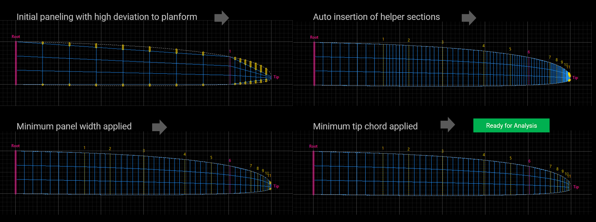


### Smooth Mesh

For **Bezier-based planforms**, the Smooth mesh follows the curved outline at the panel stations rather than approximating it with larger trapezoidal segments. This provides the closest geometric representation of the designed planform for built-in analysis.

Set the number and distribution of panels along the chord (x) and across the span (y). Smooth paneling offers no geometric advantage for an already trapezoidal planform.


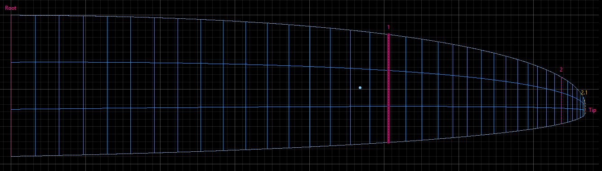

Smooth meshes cannot be exported to Xflr5 or FLZ_vortex, as these tools require trapezoidal meshes. Use a trapezoidal mesh when preparing an external analysis.

### Mesh Optimization

Both mesh types offer additional controls:

* **Minimum chord ratio between sections** - Insert panel-only sections where the chord decreases too much between neighboring sections. This improves interpolation of Reynolds-number-dependent airfoil polars.
* **Minimum panel width** - Avoid excessively narrow spanwise panels.
* **Minimum chord for tip** - Trim very small tip chords in the analysis mesh to avoid regions with very low Reynolds numbers, where airfoil polar data can become unreliable.

These settings affect the analysis mesh, not the designed planform. The mesh is regenerated on demand after geometry changes. 

### Export to Xflr5

PC2 exports the trapezoidal mesh definition and automatically generates the intermediate airfoils needed at its sections. The export provides the wing geometry and airfoils; flight conditions and aircraft setup are configured in Xflr5.

See [the short description](doc/PC2_export_to_Xflr5.md) for details.


### Export to FLZ_vortex


PC2 generates a ready-to-use FLZ_vortex project file that can be loaded as a new flight scene ("Flugszene"). FLZ_vortex can also be launched directly from PC2 with the project file loaded. For direct launch, the `.flz` extension must be associated with FLZ_vortex.

Do not forget to adjust the plane mass in FLZ before running a calculation.

## Aero Analysis

Aero analysis connects local aerodynamic behavior with the performance of the complete wing. Spanwise results help assess lift distribution and stall onset at a selected angle of attack, while wing polars show performance over a range of operating points.

The analysis uses the panel mesh and a T1 polar definition for the root airfoil. This defines constant-speed conditions, with Reynolds numbers scaled to the local chord along the span.

### VLM Analysis

The vortex lattice method (VLM) calculates the three-dimensional flow effects of the wing using its panel mesh. The resulting circulation and induced flow determine the lift distribution and the effective angle of attack along the span.

A purely inviscid VLM assumes a linear lift response and cannot determine stall onset on its own. PC2 combines the VLM solution with two-dimensional airfoil polars from NeuralFoil or Xfoil in a **viscous loop**. The local effective angles of attack are used to evaluate the airfoil lift response, and the VLM solution is iteratively adjusted to account for its nonlinearity.

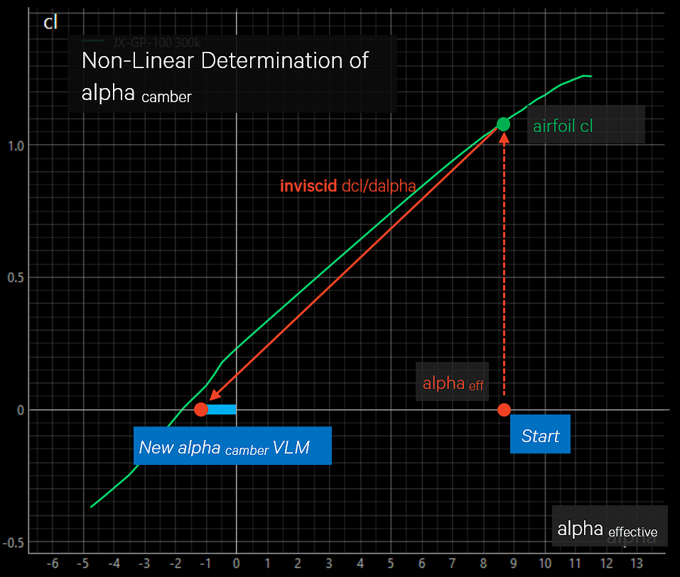

Wing drag combines two contributions:

* **Airfoil drag** is taken from the section polars at the calculated local lift coefficients and integrated along the span.
* **Induced drag** is calculated using a far-field **Trefftz-plane** evaluation of the trailing wake. This captures the drag associated with the wing's lift distribution.

Their sum gives the wing drag coefficient `CD`; together with `CL`, it provides the wing's glide ratio `CL/CD`. These are wing-only results: drag from the fuselage, tail and other aircraft components is not included.

The method supports performance comparison and identification of stall onset, not prediction of separated flow or post-stall behavior. Results depend on both mesh resolution and the reliability of the underlying airfoil polars, especially near maximum lift and at low Reynolds numbers.

### Aero along Span

For a selected angle of attack, spanwise diagrams show how the aerodynamic loading varies from root to tip. The lift distribution provides an overview; the local lift coefficient and effective angle of attack help explain how each region operates relative to its airfoil limits.

Drag and pitching-moment distributions provide additional insight into the contributions of different wing regions.

Setting the angle of attack to its automatically determined maximum highlights the critical regions where local lift reaches the airfoil's maximum lift coefficient. This indicates where stall is expected to begin, rather than assuming that the complete wing stalls at once.

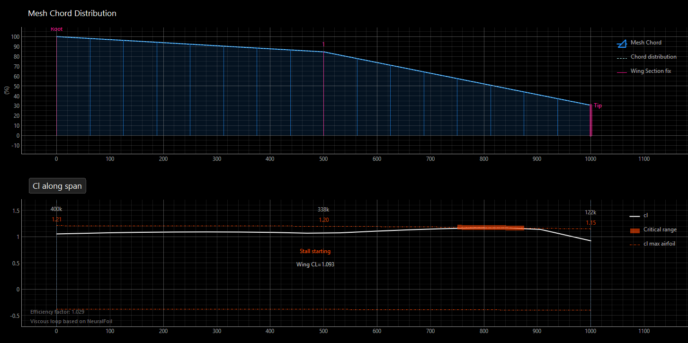

<sup>Critical wing regions near stall onset, where the local lift coefficient reaches the airfoil limit.</sup>

Show the chord distribution alongside the aerodynamic results to adjust it interactively and assess how the loading and critical regions move. This makes it possible to refine the planform for the intended stall progression, for example by reducing the tendency toward tip stall.

The current operating point can be exported as a CSV report containing overall wing results and spanwise data, including lift, drag, moment and effective angles of attack.

### Wing Polar

A wing polar combines operating points over a range of angles of attack at the constant speed defined by the selected T1 polar. PC2 calculates the polar up to the estimated onset of stall.

Different variable combinations reveal different aspects of performance: `CL` versus `CD` shows the drag polar, while `CL/CD` versus `CL` shows where the wing achieves its best glide ratio. Pitching-moment results describe how the wing's moment varies over the operating range. Airfoil and induced drag contributions are shown separately to understand what limits performance.

Optional **key performance indicators** mark characteristic values such as maximum `CL`, minimum `CD` and maximum `CL/CD`, depending on the selected diagram. A level-flight point can also be shown for a specified mass or wing loading, identifying the operating point where wing lift balances weight at the selected speed.

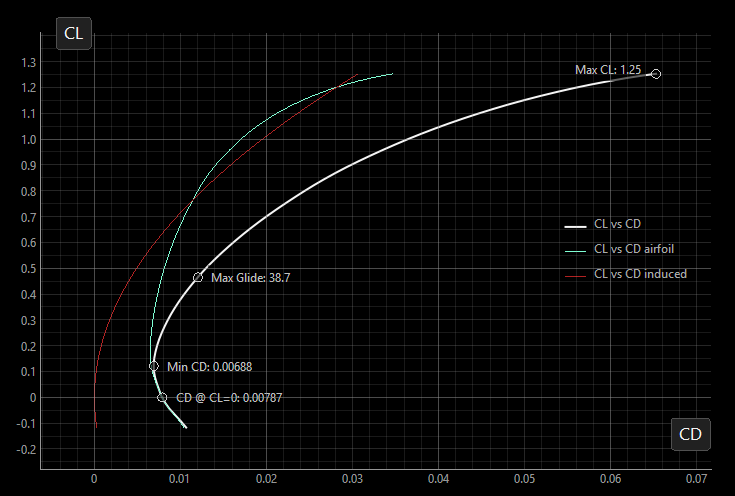


#### Comparison with a Reference Wing

Use a reference wing to assess a design against an existing baseline rather than judging its polar in isolation. PC2 provides an elliptical reference planform and supports loading other PC2 designs as references.

Reference geometry can be used without scaling or matched to selected dimensions of the current wing: span and area, root chord and area, or root chord and span. Choose the matching conditions to suit the comparison.

The reference results are overlaid on the spanwise diagrams and wing polars. Additional **delta diagrams** show the differences over the shared operating range. For example, comparing `CD` and `CL/CD` at the same `CL` reveals where a design reduces drag or improves glide ratio, and where it introduces a trade-off.

Drag and glide-ratio deltas are expressed as percentages relative to the reference: negative drag differences and positive glide-ratio differences indicate an improvement.

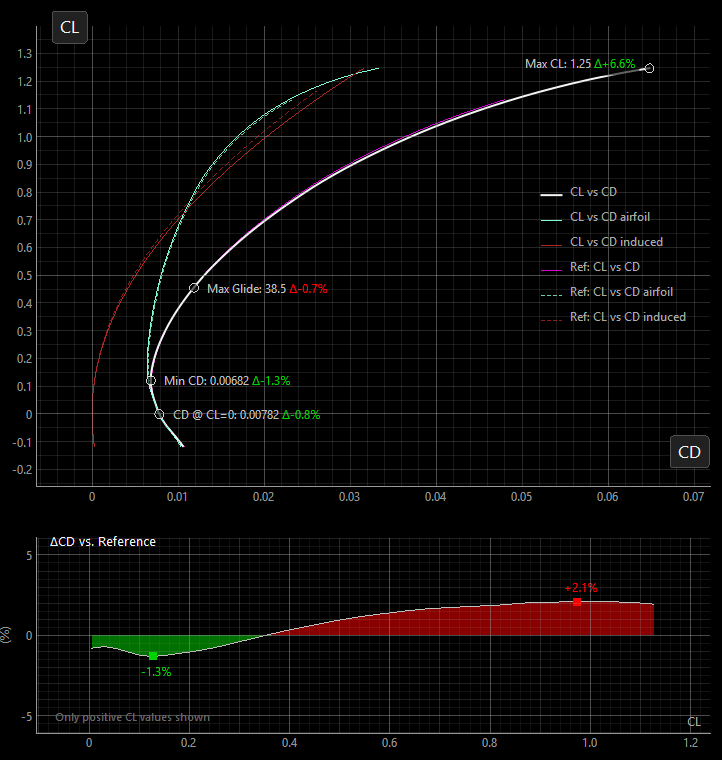


## Installation

### Windows Easy Setup

A Windows installer including Worker for Xfoil polar generation is available in the [releases section on GitHub](https://github.com/jxjo/PlanformCreator2/releases). NeuralFoil is also included.

Download and run the setup program. During installation, you can associate `.pc2` project files with the app.

Windows SmartScreen may display "Windows protected your PC" with "Unknown publisher" because the installer is not signed with a code signing certificate.

Only proceed if you downloaded the installer from this project's GitHub releases page and trust it:
1. Click "More info"
2. Click "Run anyway"


### Python Package Setup

With Python 3.12 or newer, install PlanformCreator2 as a package. NeuralFoil is included through AirfoilEditor. On Windows, Worker is also bundled; on Linux and macOS, see the additional Worker setup below if you want to use Xfoil.

Install the app:
```shell
python -m pip install planformcreator2
```

To upgrade to the latest version, use `python -m pip install --upgrade planformcreator2`.

Run the app by typing `planformcreator2` on the command line.


### Linux and macOS

Use the Python package setup above, replacing `python` with `python3` if needed.

NeuralFoil polar generation and the built-in wing analysis do not require Worker.

#### Preparing Worker for Xfoil
For Xfoil polar generation on Linux and macOS, compile `worker` and make it available on your `PATH` (for example in `/usr/local/bin`).

See the [Xoptfoil2 installation instructions](https://github.com/jxjo/Xoptfoil2#installation) for details.

#### Ubuntu

If startup fails with a Wayland-related message such as "Failed to create wl_display", try launching with `QT_QPA_PLATFORM=xcb planformcreator2`.

### Running from Source

For local development, clone the repository and install it in editable mode from the repository root, preferably in a virtual environment. This also installs the dependencies declared by the project:

```shell
python -m pip install -e .
planformcreator2
```

## Changelog

See [CHANGELOG.md](CHANGELOG.md) for history of changes.


## Finally

PlanformCreator2 was originally inspired by the "Planform Creator" module of [The Strak Machine](https://github.com/Matthias231/The-Strak-Machine).

The VLM calculations build on [PanelAero](https://github.com/DLR-AE/PanelAero). Thanks to Arne Voß (DLR) for providing this implementation.

Thanks to Peter Sharpe for [NeuralFoil](https://github.com/peterdsharpe/NeuralFoil), which enables fast airfoil polar generation and interactive aerodynamic analysis.

And of course, thanks to the open-source community for the many libraries and tools that make PlanformCreator2 possible.

I hope you enjoy working with **PlanformCreator2** :rocket:
