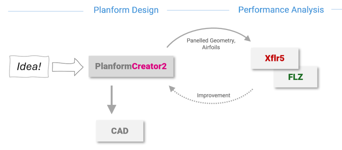
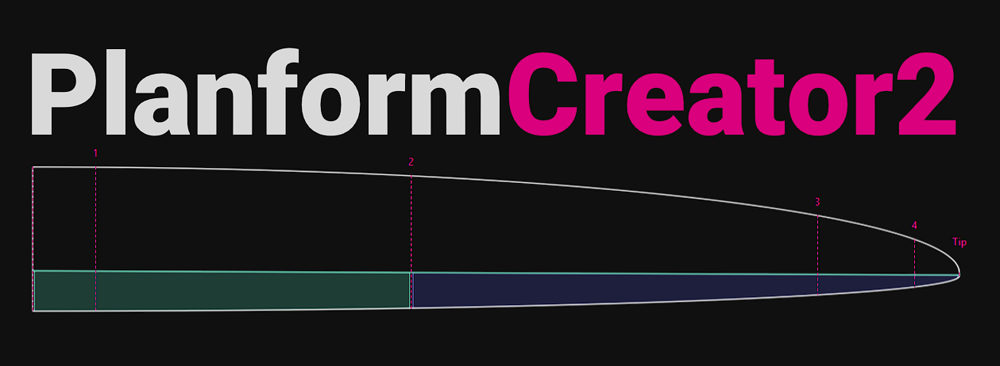
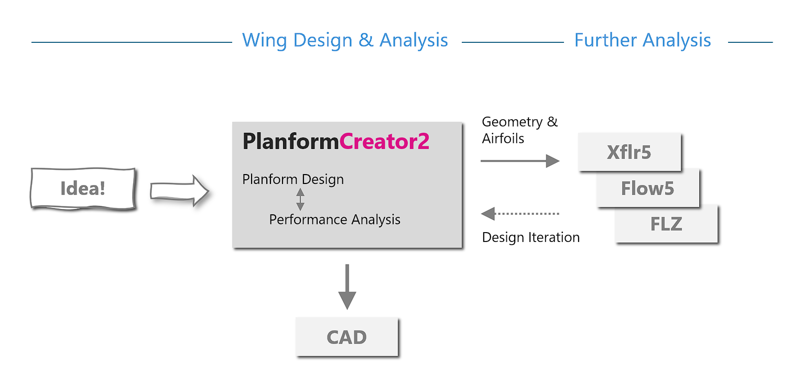
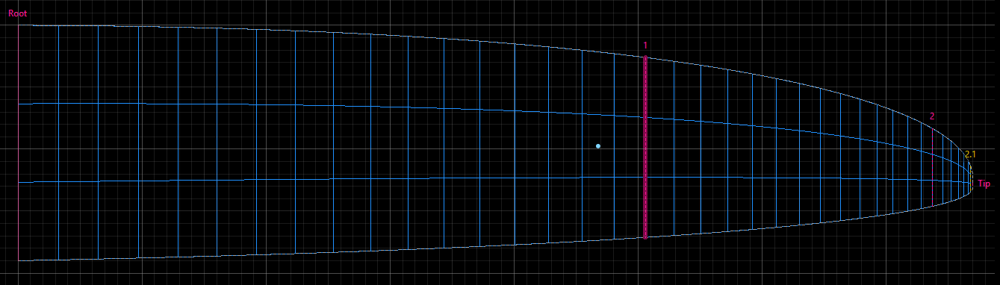
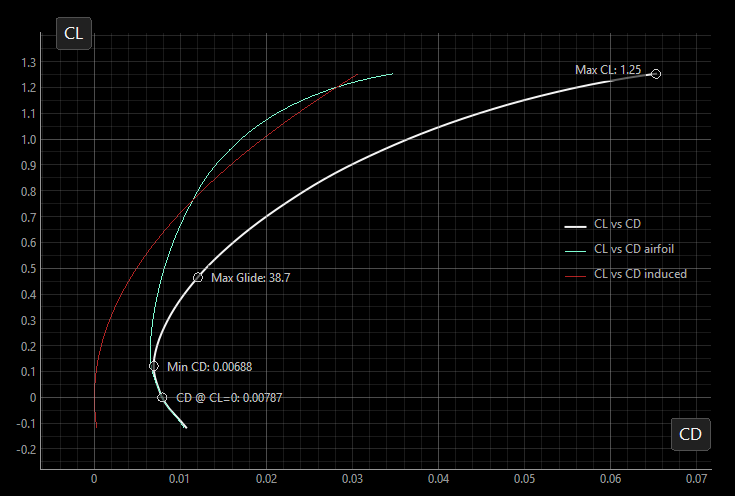
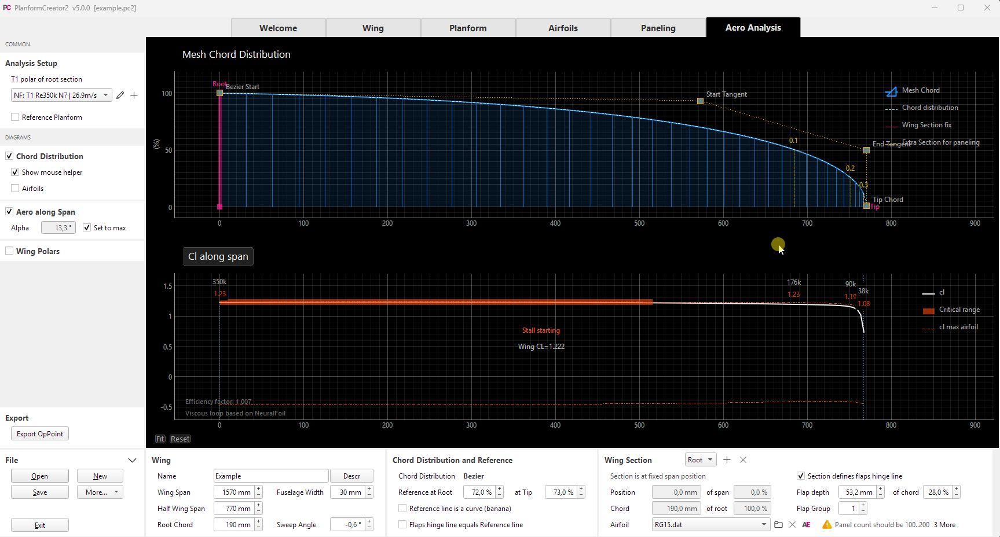
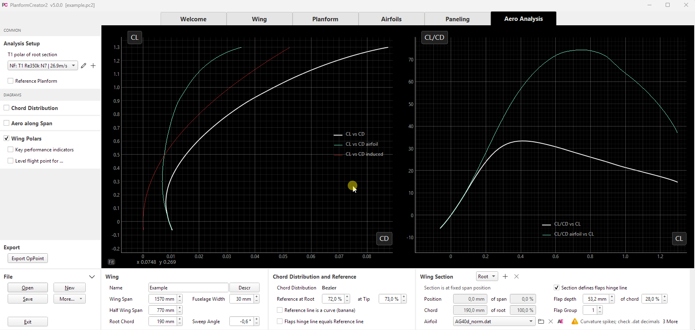
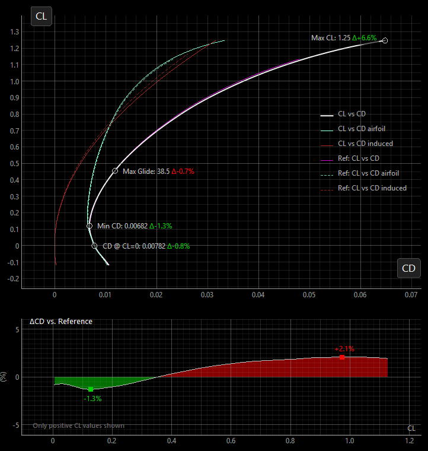

*Eigentlich war die Idee klar: Der PlanformCreator2 kümmert sich um die Geometrie einer Tragfläche. Für die aerodynamische Bewertung geht es anschließend in spezialisierte Programme wie XFLR5, flow5 oder FLZ_Vortex. So war der Workflow gedacht:*

*Bei der Überarbeitung einer Tragfläche kam dann aber doch ein Wunsch auf: den Profilstrak verfeinern, den Flächengrundriss anpassen – und direkt sehen, was sich dadurch aerodynamisch verändert. Wie wirkt sich eine kleine Änderung an einem Profil auf die ganze Tragfläche aus? Wäre eine erste Bewertung nicht auch direkt im PlanformCreator2 hilfreich?*

*Die VLM-Rechnung war bereits vorhanden. Zusammen mit NeuralFoil eröffneten sich neue Möglichkeiten für eine interaktive Analyse. Aus dem Gedanken wurde nach und nach mehr: Während die neue Tragfläche Gestalt annahm, wuchsen auch die Analysemöglichkeiten im PC2. So entstand Schritt für Schritt Version 5 ...*
 

# Über Version 5.0

Der Schwerpunkt von Version 5 liegt auf der **aerodynamischen Bewertung einer Tragfläche**. Wie verändern sich ihre Eigenschaften, wenn ich den Grundriss anpasse oder ein anderes Profil verwende? Wo entsteht unnötig viel Widerstand? Und bringt eine neue Variante gegenüber einer bewährten Vergleichsfläche tatsächlich einen Vorteil?

PC2 soll darauf eine schnelle, möglichst anschauliche Antwort geben. Im Vordergrund stehen das Verständnis der Zusammenhänge und der Vergleich von Entwurfsvarianten – nicht die Vorhersage einer Flugleistung bis auf die letzte Nachkommastelle. Die Gestaltung der Tragfläche rückt damit näher an ihre aerodynamische Bewertung: etwas ändern, die Auswirkungen ansehen und den Entwurf Schritt für Schritt verfeinern.

Dabei bleibt die Betrachtung bewusst auf die Tragfläche beschränkt. Für die Flugleistung des gesamten Modells müssen auch Rumpf, Leitwerk und weitere Widerstandsanteile berücksichtigt werden. Ebenso wenig ersetzt die Tragflächenanalyse eine Untersuchung der Flugstabilität oder die Bestimmung einer geeigneten Schwerpunktlage. Dafür sind weiterhin spezialisierte Programme wie XFLR5, flow5 oder FLZ_Vortex zuständig.

Der neue Workflow sieht nun so aus:

PC2 bleibt dabei der zentrale Ort für die Geometrie. Erkenntnisse aus einer weiterführenden Analyse fließen wieder in den Entwurf ein; für die abschließende Konstruktion geht es wie bisher per Export ins CAD.

Damit diese direkte Rückmeldung beim Entwerfen möglich wird, greifen in Version 5 mehrere Neuerungen ineinander:

- Eine verbesserte **Panelisierung** bildet den entworfenen Grundriss genauer ab.
- Die Tragflächenrechnung berücksichtigt nun neben dem Auftrieb auch den **Widerstand** und das Nickmoment.
- **NeuralFoil** liefert schnell die benötigten Profilpolaren und erleichtert damit das interaktive Ausprobieren.
- Erweiterte **Referenzflächen** schaffen eine Vergleichsbasis für die Bewertung von Änderungen.
- Neue **Diagramme und Kennzahlen** machen die Ergebnisse und die Unterschiede zwischen Varianten sichtbar.

Die folgenden Abschnitte stellen die Neuerungen und die Ideen dahinter vor.

## Panelisierung

Bevor eine Tragfläche aerodynamisch berechnet werden kann, wird sie in viele kleine Felder, die sogenannten Panels, aufgeteilt. Dieses Rechennetz ist eine Annäherung an die entworfene Geometrie. Wie gut es den Grundriss abbildet und wie fein es aufgelöst ist, beeinflusst auch die Ergebnisse.

### Smooth-Paneling

Bisher wurde die Kontur für die Rechnung durch Trapezabschnitte angenähert. Für eine Trapezfläche passt das natürlich gut. Bei einem geschwungenen, mit Bezier-Kurven definierten Grundriss können zwischen den Abschnitten aber deutliche Abweichungen zur eigentlichen Kontur entstehen. Zusätzliche Hilfssektionen verkleinern diese Abweichungen, machen die Annäherung jedoch aufwendiger.

Das neue **Smooth-Paneling** setzt direkt am geschwungenen Grundriss an: An jeder Spannweitenposition des Netzes wird die tatsächliche Kontur ausgewertet.

So lässt sich der Einfluss eines geschwungenen Grundrisses auf die Auftriebsverteilung untersuchen, ohne die zusätzlichen geometrischen Abweichungen einer Trapezannäherung.

Für den **Export nach XFLR5 oder FLZ_Vortex** bleibt das trapezbasierte Paneling erhalten, da diese Programme eine entsprechende Flächendefinition benötigen. Smooth-Paneling ist für die interne Analyse im PC2 gedacht.

### Automatische Netzgenerierung

Die automatische Netzgenerierung fügt bei starken Änderungen der Flächentiefe zusätzliche Rechensektionen ein. Das verbessert die Interpolation der Profilpolaren. Weitere Einstellungen begrenzen sehr schmale Panels und erlauben es, extrem kleine Flächentiefen an der Spitze aus dem Rechenmodell auszunehmen.

Warum ist die kleine Flächentiefe an der Spitze ein Thema? Bei gleicher Geschwindigkeit sinkt die Reynolds-Zahl proportional zur Flächentiefe – an schmal auslaufenden Modellflugflächen bis unter 10.000. Dort sind berechnete Profilpolaren häufig nur eingeschränkt belastbar, wobei es keine allgemeingültige Grenze gibt. Hinzu kommen dreidimensionale Strömungseffekte wie Querströmungen: Die VLM erfasst zwar die dreidimensionalen Auftriebseffekte, die ergänzenden 2D-Profilpolaren beschreiben die lokale Strömung aber nur näherungsweise. Deshalb ist es meist sinnvoll, den äußersten Bereich mit sehr kleiner Flächentiefe auszunehmen, statt unsichere Ergebnisse in die Gesamtbewertung einfließen zu lassen.

Diese Einstellungen verändern nur das Rechenmodell, nicht den entworfenen Grundriss. Bei Geometrieänderungen wird das Netz für die VLM-Berechnung automatisch neu erzeugt.

Mehr Panels bringen nicht automatisch bessere Ergebnisse: Für Auftrieb und Widerstand reichen erfahrungsgemäß häufig 30 bis 50 Panels in Spannweitenrichtung (y) und zwei in Tiefenrichtung (x). Ein feineres Netz erhöht den Rechenaufwand, verändert die Ergebnisse aber oft kaum. Für genauere Nickmomente kann eine höhere x-Auflösung sinnvoll sein. Diese Zahlen sind eine Orientierung, keine feste Grenze.

## Erweiterung um Widerstand

Eine passende Auftriebsverteilung und ein gutmütiger Beginn des Strömungsabrisses sind wichtige Entwurfsziele. Für die Leistungsbewertung fehlt aber noch eine entscheidende Größe: Wie viel Widerstand erzeugt die Tragfläche dabei?

Version 5 ermittelt dafür die Widerstandsverteilung entlang der Spannweite. Der Widerstand setzt sich aus zwei Anteilen zusammen:

- **Profilwiderstand:** Er entsteht durch Reibung und die Druckverteilung am Profil. PC2 entnimmt ihn den Profilpolaren für den jeweils berechneten lokalen Auftriebsbeiwert. Zwischen den benachbarten Sektionen wird unter Berücksichtigung der örtlichen Reynolds-Zahl interpoliert.
- **Induzierter Widerstand:** Er ist mit der Auftriebserzeugung einer Tragfläche endlicher Spannweite verbunden. Die dabei entstehende Wirbelschleppe verändert die Anströmung der Fläche. Seine Größe hängt unter anderem von der Spannweite und der Auftriebsverteilung ab.

Den induzierten Widerstand ermittelt PC2 mit einer **Far-Field-Analyse in der Trefftz Plane**, wie sie auch in XFLR5 verwendet wird. Anschaulich wird dabei die Wirkung der Wirbelschleppe weit hinter der Tragfläche ausgewertet, statt den Widerstand unmittelbar an der Oberfläche zu bestimmen.

Aus den Beiträgen über die Spannweite ergibt sich der Gesamtwiderstand der Tragfläche für einen Betriebspunkt, also für eine bestimmte Fluggeschwindigkeit und einen bestimmten Anstellwinkel.

### Vom Betriebspunkt zur Tragflächenpolare

Mit dem Auftriebsbeiwert `CL` und dem Widerstandsbeiwert `CD` lässt sich nun auch das Verhältnis von Auftrieb zu Widerstand `CL/CD` (Gleitzahl) berechnen.

Hier gilt die Abgrenzung vom Anfang: PC2 zeigt die Gleitzahl **der Tragfläche allein**. Ein Wert von beispielsweise 30 bedeutet also nicht, dass das fertige Modell aus einem Meter Höhe 30 Meter weit gleiten wird. Dazu fehlen in der Rechnung unter anderem die Widerstände von Rumpf und Leitwerk.

Wird die Berechnung für viele kleine Anstellwinkelschritte wiederholt, entsteht eine Tragflächenpolare. PC2 verwendet dafür eine T1-Polare: Die Geschwindigkeit bleibt konstant, während sich Anstellwinkel und Auftrieb ändern.

Die Beiträge von Profil- und induziertem Widerstand lassen sich getrennt betrachten. Das hilft zu verstehen, warum eine Änderung nur in einem bestimmten Bereich Vorteile bringt: Bei kleinen Auftriebsbeiwerten fällt häufig der Profilwiderstand stärker ins Gewicht, bei hohen Auftriebsbeiwerten wächst der induzierte Anteil.

Optional markieren **Kennzahlen** charakteristische Punkte wie den kleinsten Widerstandsbeiwert, den größten Auftriebsbeiwert oder die beste Gleitzahl. Für eine vorgegebene Masse oder Flächenbelastung lässt sich außerdem der Betriebspunkt anzeigen, an dem die Tragfläche bei der gewählten Geschwindigkeit das Gewicht trägt. So erhält die Polare einen Bezug zum geplanten Einsatz.

### Was die Rechnung leisten kann – und was nicht

Die Vortex-Lattice-Methode (VLM) beschreibt zunächst eine reibungsfreie Strömung. Erst die Verbindung mit den Profilpolaren liefert die Informationen über den Profilwiderstand und die Grenzen des lokalen Auftriebs. PC2 nutzt diese Kombination, um unter anderem abzuschätzen, in welchem Bereich der Tragfläche der Strömungsabriss beginnt. Die Polare wird bis zu diesem geschätzten Beginn berechnet – das Verhalten einer bereits abgerissenen Strömung kann sie nicht vorhersagen.

Wie belastbar das Ergebnis ist, hängt deshalb sowohl vom Rechennetz als auch von den zugrunde liegenden Profilpolaren ab. Die Rechnung dient vor allem dazu, die Auswirkungen von Änderungen am Profil oder Grundriss zu beurteilen.

Eine T2-Polare für den stationären Gleitflug, bei der sich die Geschwindigkeit an den jeweiligen Auftrieb anpasst, wurde nicht implementiert, da der zusätzliche Rechenaufwand eine interaktive Analyse zu stark ausbremsen würde.

## Integration von NeuralFoil

Wie bereits im AirfoilEditor 5 steht nun auch im PC2 [NeuralFoil](https://github.com/peterdsharpe/NeuralFoil) als Alternative zu Xfoil zur Verfügung. Damit lassen sich Profilpolaren praktisch in Echtzeit ermitteln.

NeuralFoil ist ein von Peter Sharpe entwickeltes neuronales Netz, das mit einer großen Zahl von Xfoil-Rechnungen trainiert wurde. Aus der Profilgeometrie und den Strömungsbedingungen sagt es unter anderem Auftrieb, Widerstand und Nickmoment voraus, ohne dafür jedes Mal eine vollständige Xfoil-Rechnung durchzuführen. Eine ausführlichere Einführung gibt es im [Artikel zum AirfoilEditor 5](https://github.com/jxjo/AirfoilEditor/blob/main/doc/ABOUT_5.0.md).

Die Wahl zwischen Xfoil und NeuralFoil erfolgt in der Polardefinition. NeuralFoil eignet sich besonders für das schnelle Ausprobieren und Vergleichen. Wichtige Ergebnisse sollten anschließend mit Xfoil gegengeprüft werden – insbesondere nahe dem maximalen Auftrieb oder bei kleinen Reynolds-Zahlen. Beide Verfahren liefern Modellrechnungen, keine Messwerte.

### Demo: Grundriss verändern

In der folgenden Demo wird die Tiefenverteilung einer Tragfläche interaktiv verändert. Parallel zeigt die Verteilung des lokalen Auftriebsbeiwerts, welcher Bereich zuerst sein Auftriebsmaximum erreicht und damit zum Strömungsabriss neigt. So lässt sich direkt untersuchen, wie der Grundriss den erwarteten Beginn des Abrisses beeinflusst.

Im Hintergrund läuft dabei eine umfangreiche Rechenkette ab: Das Netz wird aktualisiert, benötigte Zwischenprofile werden gestrakt und deren Polaren mit NeuralFoil ermittelt. Die anschließende VLM-Rechnung verwendet die interpolierten Polarenwerte für jeden Streifen entlang der Spannweite.

### Demo: Profil ersetzen

Im zweiten Beispiel wird das Profil an der Tragflächenwurzel geändert. Damit ändern sich auch die daraus gestrakten Zwischenprofile und ihre Polaren. PC2 berechnet daraufhin die Tragflächenpolare neu: Die Wirkung der Profiländerung lässt sich so für die gesamte Tragfläche und über einen Bereich von Anstellwinkeln beurteilen, statt nur die einzelne Profilpolare zu betrachten.

## Erweiterte Referenzflächen

Wie schlägt sich der neue Entwurf gegenüber einer bewährten Tragfläche oder einer früheren Variante? Dafür lassen sich nun mehrere PC2-Entwürfe als Referenzflächen hinzuladen. Zusätzlich steht ein elliptischer Referenzgrundriss zur Verfügung.

Die Referenz kann in Originalgröße bleiben oder in jeweils zwei Größen an die aktuelle Fläche angepasst werden:

- Wurzeltiefe und Flächeninhalt
- Spannweite und Flächeninhalt
- Wurzeltiefe und Spannweite

So lassen sich beispielsweise unterschiedliche Grundrisse bei gleicher Spannweite und gleichem Flächeninhalt vergleichen. Für eingeblendete Referenzflächen berechnet PC2 automatisch die aerodynamischen Ergebnisse auf Basis der aktuell gewählten Polardefinition. Die Verteilungen entlang der Spannweite und die Tragflächenpolaren werden zum direkten Vergleich überlagert.

### Delta-Polare

Liegen zwei Polaren dicht beieinander, sind ihre Unterschiede oft schwer zu erkennen. Die **Delta-Polare** zeigt deshalb direkt die Abweichung zur Referenz. Bei gleichem Auftriebsbeiwert `CL` lässt sich beispielsweise ablesen, in welchem Bereich der neue Entwurf weniger Widerstand erzeugt oder eine bessere Gleitzahl erreicht – und wo er dafür Nachteile in Kauf nimmt.

Die Unterschiede bei Widerstand und Gleitzahl werden in Prozent bezogen auf die Referenz angegeben: Ein negativer Wert beim Widerstand und ein positiver Wert bei der Gleitzahl bedeuten eine Verbesserung. Verglichen wird nur der Betriebsbereich, den beide Polaren abdecken.

In der Delta-Polare kommt schließlich alles zusammen: vom Grundriss über den Profilstrak bis zur aerodynamischen Bewertung. Aus einer Änderung am Entwurf wird ein sichtbarer Unterschied zur Referenz. Ob dieser Unterschied ein Fortschritt ist, entscheidet dabei der geplante Einsatz – nicht jede Verbesserung muss über den gesamten Betriebsbereich gelten.

---

Damit sind wir wieder bei der Frage vom Anfang: Was bringt eine kleine Änderung an der Tragfläche? Version 5 macht es leichter, dieser Frage nachzugehen und die Zusammenhänge besser zu verstehen.

Probiert es an einem eigenen Entwurf aus: den bisherigen Stand als Referenz laden, eine Idee umsetzen und schauen, was sich verändert.

Viel Erfolg mit PlanformCreator2 5.0 :rocket:

Jochen