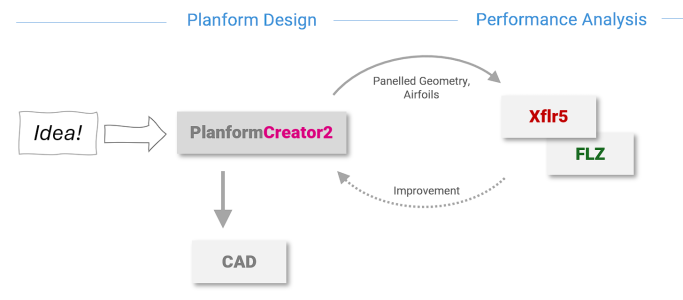
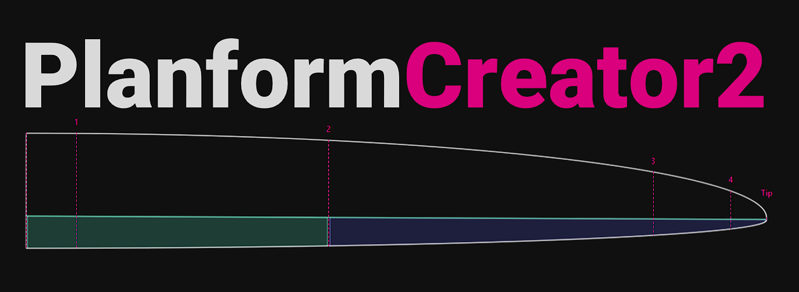
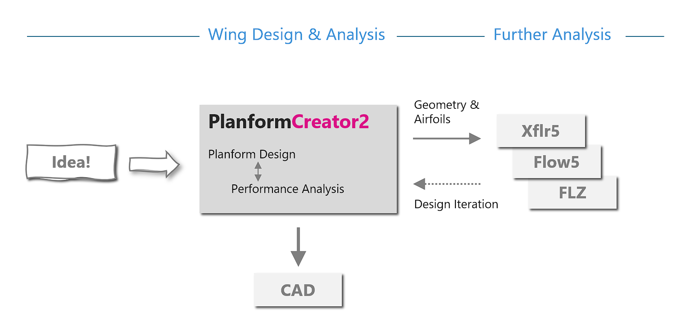
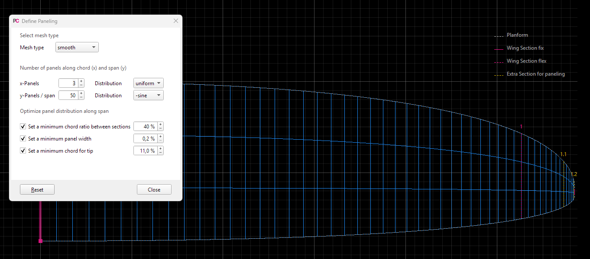
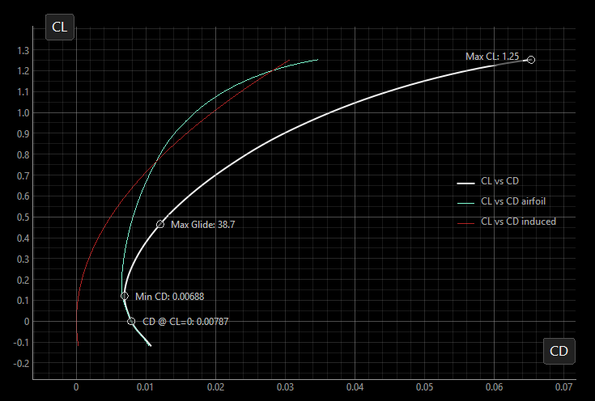
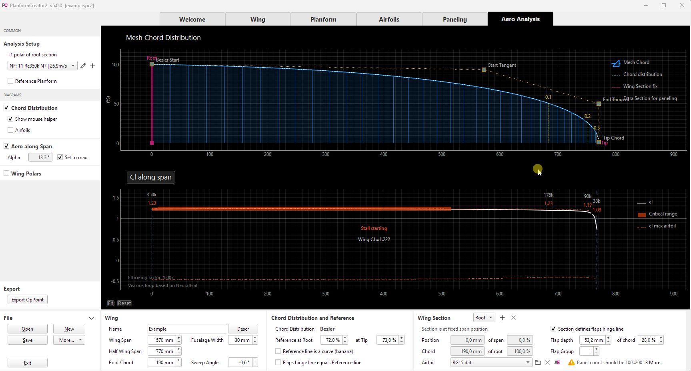
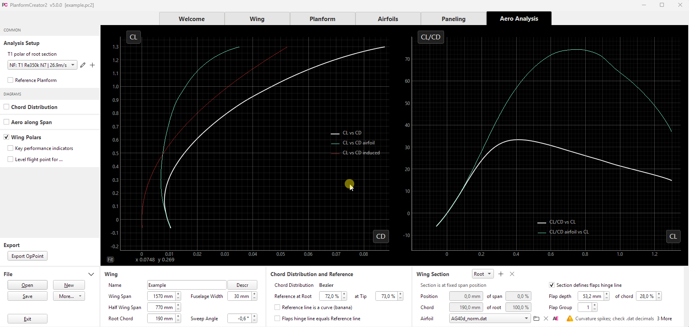
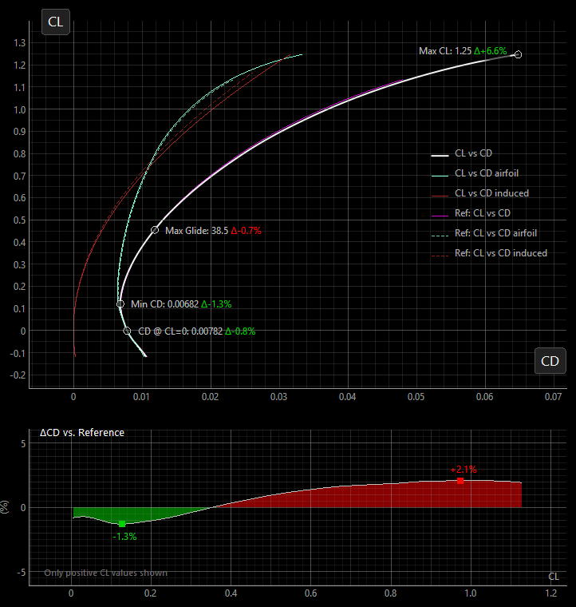

*The original idea was straightforward: PlanformCreator2 takes care of wing geometry. For aerodynamic assessment, the design then moves on to specialized programs such as XFLR5, flow5 or FLZ_Vortex. That was the intended workflow:*

*While revising a wing, though, I found myself wanting something more: refine the airfoil selection along the span, adjust the planform - and see straight away what changes aerodynamically. How does a small change to an airfoil affect the whole wing? Wouldn't an initial assessment directly in PlanformCreator2 be useful?*

*The VLM calculation was already there. Together with NeuralFoil, it opened up new possibilities for interactive analysis. The idea gradually grew: as the new wing took shape, so did the analysis capabilities in PC2. Step by step, version 5 emerged ...*

# About Version 5.0

Version 5 focuses on **assessing the aerodynamics of a wing**. How do its characteristics change when I adjust the planform or use a different airfoil? Where is unnecessary drag being generated? And does a new variant actually offer an advantage over a proven reference wing?

PC2 aims to provide quick, clear answers to these questions. The emphasis is on understanding the relationships and comparing design variants, rather than predicting flight performance to the last decimal place. Wing design and aerodynamic assessment become more closely connected: make a change, look at its effects and refine the design step by step.

The analysis deliberately remains limited to the wing. Predicting the performance of the complete model also requires the fuselage, tail and other drag contributions to be taken into account. Likewise, wing analysis does not replace a study of flight stability or the determination of a suitable center of gravity. These tasks still belong in specialized programs such as XFLR5, flow5 or FLZ_Vortex.

The new workflow now looks like this:

PC2 remains the central place for geometry. Findings from further analysis feed back into the design; for the final construction work, the geometry is exported to CAD as before.

Several new features work together to make this direct feedback possible during design:

- Improved **paneling** represents the designed planform more accurately.
- Wing analysis now includes **drag** and pitching moment alongside lift.
- **NeuralFoil** quickly provides the required airfoil polars, making interactive exploration easier.
- Extended **reference wings** provide a baseline for assessing changes.
- New **diagrams and key performance indicators** make results and differences between variants visible.

The following sections introduce these features and the ideas behind them.

## Paneling

Before a wing can be analyzed aerodynamically, it is divided into many small elements called panels. This computational mesh approximates the designed geometry. Both how closely it follows the planform and how finely it is resolved affect the results.

### Smooth Paneling

Previously, the outline was approximated by trapezoidal segments for the calculation. This naturally works well for a trapezoidal wing. For a curved planform defined by Bezier curves, however, the segments can deviate significantly from the actual outline. Additional helper sections reduce these deviations, but require a more elaborate approximation.

The new **Smooth paneling** works directly with the curved planform: the actual outline is evaluated at each spanwise mesh station.

This allows the effect of a curved planform on the lift distribution to be studied without the additional geometric deviations introduced by a trapezoidal approximation.

Trapezoidal paneling remains available for **export to XFLR5 or FLZ_Vortex**, as these programs require that type of wing definition. Smooth paneling is intended for PC2's built-in analysis.

### Automatic Mesh Generation

Automatic mesh generation inserts additional analysis sections where the chord changes substantially. This improves the interpolation of airfoil polars. Further settings limit excessively narrow panels and allow regions with extremely small tip chords to be excluded from the analysis mesh.

Why do small tip chords matter? At a constant speed, the Reynolds number decreases in proportion to chord length - potentially falling below 10,000 near the narrow tips of model aircraft wings. Calculated airfoil polars are often less reliable in this range, although there is no universal cutoff. Three-dimensional flow effects such as spanwise flow also come into play: while VLM captures three-dimensional lift effects, the supporting 2D airfoil polars only approximate the local flow. It therefore often makes sense to exclude the outermost region with very small chords rather than let uncertain results influence the overall assessment.

These settings affect only the analysis model, not the designed planform. When the geometry changes, the mesh for the VLM calculation is regenerated automatically.

More panels do not automatically mean better results: experience shows that 30 to 50 panels in the spanwise direction (y) and two in the chordwise direction (x) are often sufficient for lift and drag assessment. A finer mesh increases the computational effort but often makes little difference to these results. A higher x resolution can be useful for more accurate pitching moments. These numbers are a guide, not a fixed limit.

## Adding Drag to the Analysis

A suitable lift distribution and a gentle onset of stall are important design goals. But one essential quantity is still missing from a performance assessment: how much drag does the wing generate?

Version 5 now calculates the spanwise drag distribution. Drag consists of two contributions:

- **Airfoil drag:** This arises from friction and the pressure distribution around the airfoil. PC2 obtains it from the airfoil polars at the calculated local lift coefficient. Values are interpolated between neighboring sections, taking the local Reynolds number into account.
- **Induced drag:** This is associated with lift generation by a wing of finite span. The resulting trailing wake changes the flow approaching the wing. Its magnitude depends on factors including span and lift distribution.

PC2 calculates induced drag using a **far-field analysis in the Trefftz plane**, an approach also used in XFLR5. In simple terms, it evaluates the effect of the trailing wake far behind the wing rather than determining drag directly at the surface.

Integrating the contributions along the span gives the total wing drag for an operating point, defined by a particular flight speed and angle of attack.

### From an Operating Point to a Wing Polar

With the lift coefficient `CL` and drag coefficient `CD`, the lift-to-drag ratio `CL/CD` (glide ratio) can now also be calculated.

The distinction made at the beginning applies here: PC2 shows the glide ratio **of the wing alone**. A value of 30, for example, does not mean that the finished model will glide 30 meters for every meter of height lost. Among other things, fuselage and tail drag are not included in the calculation.

Repeating the calculation in small angle-of-attack steps produces a wing polar. PC2 uses a T1 polar: speed remains constant while angle of attack and lift change.

Airfoil and induced drag contributions can be viewed separately. This helps explain why a change may offer benefits only in a particular operating range: airfoil drag often plays a larger role at low lift coefficients, while the induced contribution grows at high lift coefficients.

Optional **key performance indicators** mark characteristic points such as minimum drag coefficient, maximum lift coefficient and best glide ratio. For a specified mass or wing loading, the operating point where wing lift balances weight at the selected speed can also be displayed. This connects the polar to the intended use.

### What the Calculation Can Do - and What It Cannot

The vortex lattice method (VLM) initially describes an inviscid flow. Combining it with airfoil polars provides information about airfoil drag and the limits of local lift. PC2 uses this combination to estimate, among other things, where stall begins along the wing. The polar is calculated up to this estimated onset; it cannot predict the behavior of an already stalled flow.

The reliability of the result therefore depends on both the mesh and the underlying airfoil polars. The calculation is primarily a tool for assessing the effects of changes to the airfoils or planform.

A T2 polar for steady gliding flight, where speed adjusts to the required lift, has not been implemented because the additional computational effort would slow down interactive analysis too much.

## NeuralFoil Integration

As in AirfoilEditor 5, [NeuralFoil](https://github.com/peterdsharpe/NeuralFoil) is now available in PC2 as an alternative to Xfoil. It allows airfoil polars to be generated practically in real time.

NeuralFoil is a neural network developed by Peter Sharpe and trained on a large number of Xfoil calculations. From airfoil geometry and flow conditions, it predicts quantities including lift, drag and pitching moment without performing a full Xfoil calculation each time. A more detailed introduction is available in the [article about AirfoilEditor 5](https://github.com/jxjo/AirfoilEditor/blob/main/doc/ABOUT_5.0.md).

The choice between Xfoil and NeuralFoil is made in the polar definition. NeuralFoil is particularly useful for quick exploration and comparison. Important results should subsequently be cross-checked with Xfoil, especially near maximum lift or at low Reynolds numbers. Both methods provide model predictions, not measurements.

### Demo: Changing the Planform

In the following demo, the wing's chord distribution is adjusted interactively. At the same time, the local lift coefficient distribution shows which region reaches its maximum lift first and is therefore prone to stall. This makes it possible to explore directly how the planform affects the expected onset of stall.

A substantial calculation chain runs in the background: the mesh is updated, the required intermediate airfoils are blended and their polars are generated using NeuralFoil. The subsequent VLM calculation uses interpolated polar values for each spanwise strip.

### Demo: Replacing an Airfoil

In the second example, the root airfoil is changed. This also changes the intermediate airfoils blended from it and their polars. PC2 then recalculates the wing polar: the effect of the airfoil change can be assessed for the whole wing over a range of angles of attack, rather than just by looking at the individual airfoil polar.

## Extended Reference Wings

How does the new design compare with a proven wing or an earlier variant? Multiple PC2 designs can now be loaded as reference wings. An elliptical reference planform is also available.

The reference can retain its original size or be scaled to match two dimensions of the current wing:

- Root chord and wing area
- Span and wing area
- Root chord and span

This allows different planforms to be compared at the same span and wing area, for example. For visible reference wings, PC2 automatically calculates the aerodynamic results using the currently selected polar definition. Spanwise distributions and wing polars are overlaid for direct comparison.

### Delta Polar

When two polars lie close together, their differences can be hard to see. The **delta polar** therefore shows the deviation from the reference directly. At the same lift coefficient `CL`, for example, it reveals where the new design produces less drag or achieves a better glide ratio - and where it comes at a cost.

Drag and glide-ratio differences are expressed as percentages relative to the reference: a negative drag difference and a positive glide-ratio difference indicate an improvement. Only the operating range covered by both polars is compared.

The delta polar is where everything comes together: from planform and spanwise airfoil distribution to aerodynamic assessment. A design change becomes a visible difference relative to the reference. Whether that difference is an improvement depends on the intended use - a benefit does not have to extend across the entire operating range.

---

This brings us back to the question at the beginning: what does a small change to the wing actually achieve? Version 5 makes it easier to explore that question and understand the relationships.

Try it with one of your own designs: load the current version as a reference, put an idea into practice and see what changes.
