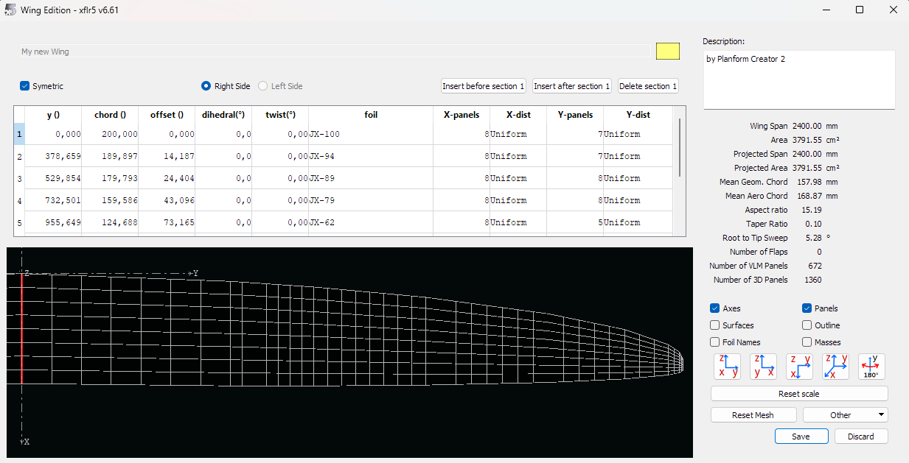

## Export to Xflr5

When PC2 is used together with Xflr5, its main benefit, besides defining the wing segments, is the automatic generation of all intermediate airfoils required at every wing section in Xflr5. No further geometric work is needed for the wing or its airfoils.

#### Steps

| # | App   | Module                            | Action |
| :--- | :--- | :---                             | :---   |
| 1 | PC2   | Wing Analysis                     | Export the wing definition (xml) and all airfoils involved to a subdirectory using 'Export to Xflr5'. |
| 2 | Xflr5 | Direct Foil Design                | Open all exported airfoils in a single step. |
| 3 | Xflr5 | Xfoil Direct Analysis             | Run a batch analysis of all airfoils with a polar set covering the complete Reynolds number range. |
| 4 | Xflr5 | Wing and Plane Design             | Create a new plane. |
| 5 | Xflr5 | Wing and Plane Design - Edit Wing | Click the menu button 'Other' and select 'Import Wing from xml file'. |
| 6 | Xflr5 | Wing and Plane Design             | The wing is ready for calculation. For T2 analysis, don't forget to define a 'Plane Mass'. |

#### Wing xml imported into Xflr5

