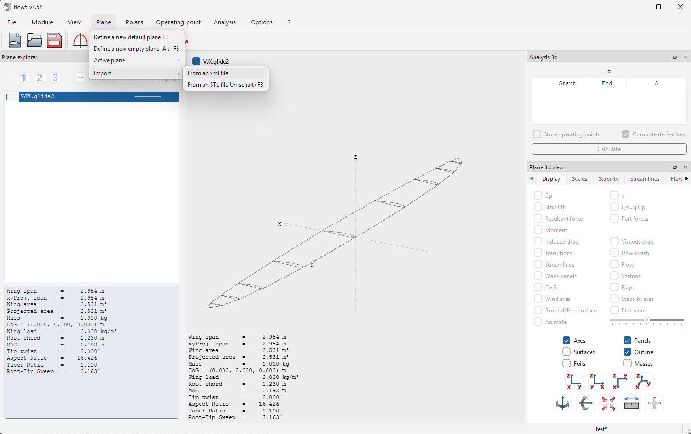

## Export to flow5

When PC2 is used together with flow5, it creates a flow5 plane containing the wing, together with all airfoils required at every wing section. The plane has the same name as the wing. No fuselage, elevator or fin is added - these are defined in flow5.

#### Steps

| # | App   | Module | Action |
| :--- | :--- | :---  | :---   |
| 1 | PC2   | Wing Analysis | Export the plane (xml) and all airfoils involved to a subdirectory using 'flow5...'. |
| 2 | flow5 | Foil Design | Use 'Load foil(s)' to open all exported airfoil `.dat` files in a single step. |
| 3 | flow5 | Foil Design | Use 'Batch Analysis' to analyze all airfoils with a polar set covering the complete Reynolds number range. |
| 4 | flow5 | Plane Design | Select 'Plane / Import / From an xml file' and choose the exported plane xml file. |
| 5 | flow5 | Plane Design | Configure the plane (mass, fuselage, tail ...) and the analysis. |

#### Plane imported into flow5

