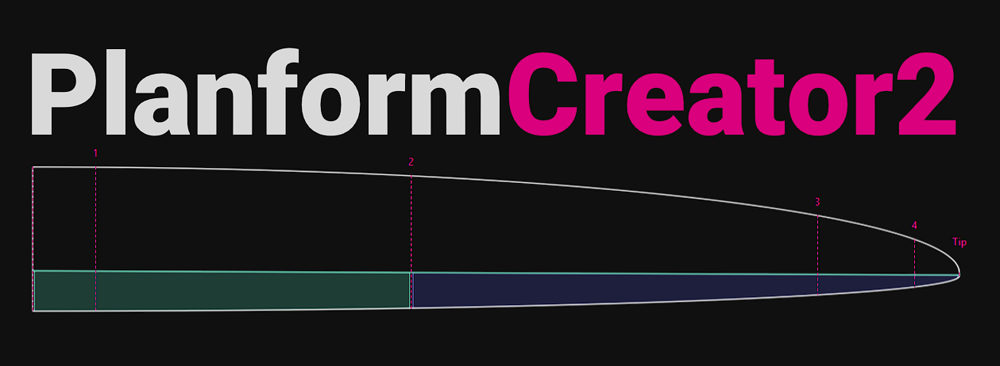
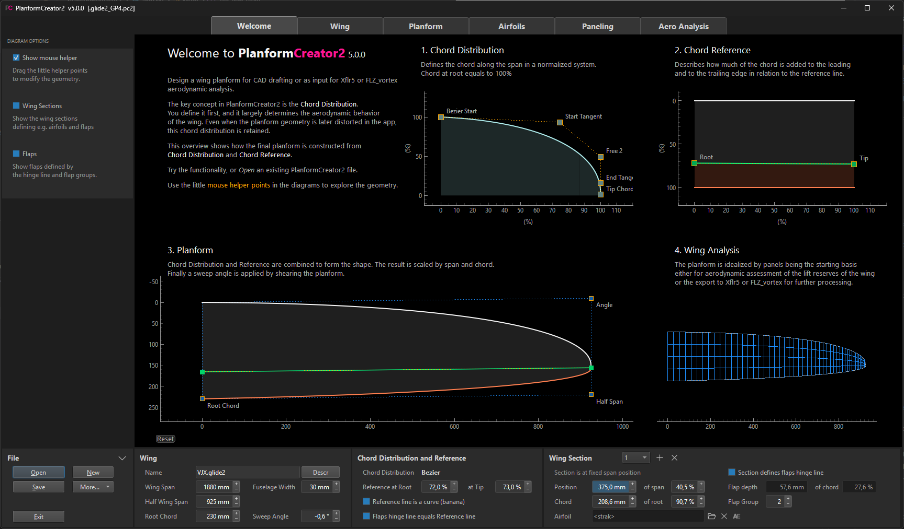

[](https://pypi.org/project/planformcreator2/)
[](https://github.com/jxjo/PlanformCreator2/releases/latest)
[](https://github.com/jxjo/PlanformCreator2/blob/main/LICENSE)
---

**PlanformCreator2** (PC2) is an app for parametric wing planform design and wing performance analysis, with a focus on model aircraft. Its interactive workflow combines geometry design with aerodynamic feedback to help compare and refine wing designs.

### Planform Design

* Define Bezier-based or trapezoidal planforms using a chord distribution and chord reference
* Import a drawing or photo as a background image
* Add wing sections at fixed span positions or relative chord lengths
* Define the flap hinge line and flap groups
* Export the planform and airfoils for use in CAD, or wing section geometry as CSV

### Airfoils and Polars

* Assign airfoils to wing sections and edit them using [AirfoilEditor](https://github.com/jxjo/AirfoilEditor)
* Generate blended airfoils for intermediate wing sections ('strak')
* Generate and view airfoil polars using [NeuralFoil](https://github.com/peterdsharpe/NeuralFoil) or Xfoil
* Automatically scale Reynolds numbers to the local chord along the span

### Paneling and Aero Analysis

* Generate trapezoidal meshes or Smooth meshes for Bezier-based planforms
* Calculate spanwise lift, drag and pitching moment using VLM combined with airfoil polar data
* Identify critical wing regions where stall is expected to begin
* Evaluate T1 wing polars, glide performance and key performance indicators
* Compare results with an elliptical reference planform or another PC2 design
* Export the wing's trapezoidal panel mesh and airfoils to Xflr5 and FLZ_vortex for further analysis

The built-in analysis supports wing design exploration and comparison; it is not a complete aircraft-performance prediction or a post-stall flow model.





## Quick Start

Requires **Python 3.12 or newer**. Install and launch from a terminal:

```shell
python -m pip install planformcreator2
planformcreator2
```

On Linux and macOS, use `python3` instead of `python` if needed.

To upgrade, use `python -m pip install --upgrade planformcreator2`.

NeuralFoil is included through AirfoilEditor and requires no additional setup. Worker for Xfoil polar generation is bundled on Windows. On Linux and macOS, compile and install Worker only if you want to use Xfoil; see the [Xoptfoil2 installation instructions](https://github.com/jxjo/Xoptfoil2#installation).

Start by exploring the sample wing in the **Welcome** panel, or use **New** to choose a predefined wing template.

For the full user guide, installation details and a Windows installer, see [PlanformCreator2 on GitHub](https://github.com/jxjo/PlanformCreator2).

Release information: [CHANGELOG](https://github.com/jxjo/PlanformCreator2/blob/main/CHANGELOG.md).
